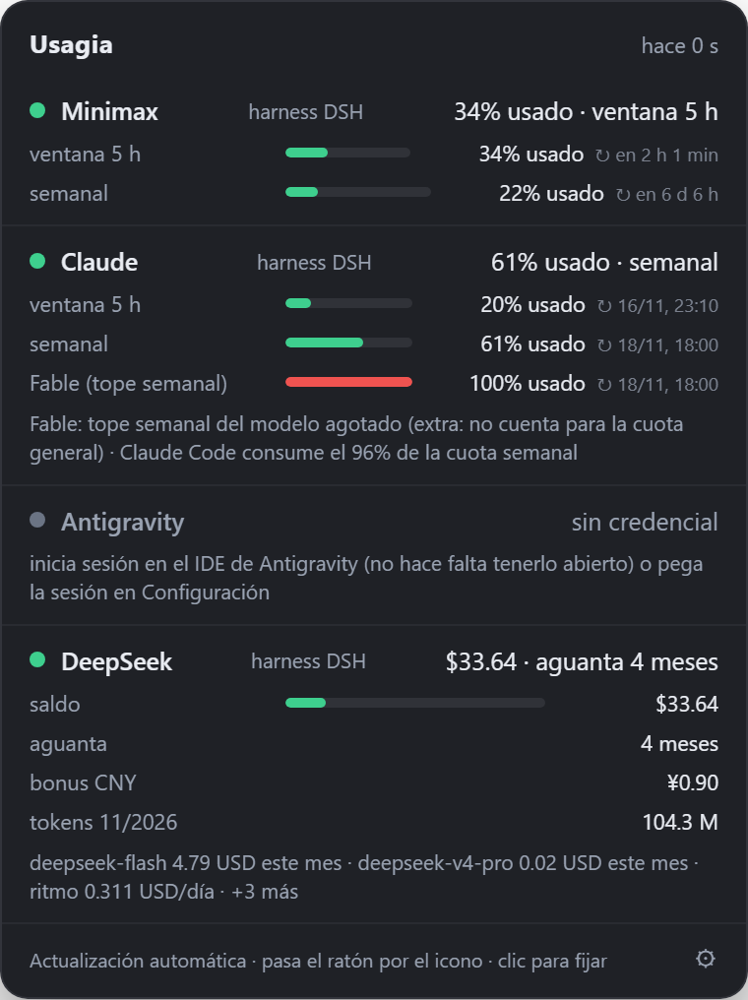

# Usagia

App de escritorio (Electron) para **ver el uso actual de tus IAs de un vistazo**:
un icono en la bandeja del sistema y, al pasar el ratón por encima, una
tarjeta con la cuota restante de cada proveedor.



Proveedores incluidos ahora mismo:

| Proveedor | Qué muestra | De dónde sale |
|---|---|---|
| **Minimax** | % restante de la ventana de 5 h y de la semanal | `api.minimax.io/v1/token_plan/remains` |
| **Claude** | % libre de la ventana de 5 h y de la semanal | `api.anthropic.com/api/oauth/usage` |
| **Antigravity** | % restante por grupo de modelos (Gemini, Claude/GPT) y por ventana | `cloudcode-pa.googleapis.com/v1internal:retrieveUserQuotaSummary` |
| **DeepSeek** | saldo, bonus, gasto del mes y tokens consumidos | `platform.deepseek.com/api/v0/...` |

Funciona en **Windows, macOS y Linux** (Electron). El comportamiento del hover
se adapta a cada sistema:

- **Windows**: tooltip nativo del sistema (multilínea) + tarjeta rica. Para que
  salga la tarjeta, el icono tiene que estar en la **zona visible** de la
  bandeja (en Windows 11 los iconos nuevos empiezan en "iconos ocultos":
  arrástralo a la barra y listo).
- **macOS / Linux**: la tarjeta aparece sobre el icono de la barra de menús.

## Instalación y arranque

```bash
npm install          # instala Electron
npm start            # arranca la app (icono en la bandeja)
```

Otros comandos:

```bash
npm run probe        # consulta los proveedores y vuelca el resultado por consola
npm run preview      # abre la tarjeta sola, con datos reales, y guarda una captura
npm run dist         # empaqueta instaladores (Windows / macOS / Linux)
```

> Si `npm install` no descarga el binario de Electron (política de scripts de
> npm), ejecuta `node node_modules/electron/install.js`.

## Cómo se autentican los proveedores

La app **no guarda claves**: lee las credenciales que ya tienes en el sistema,
en este orden:

1. Lo que escribas en `%APPDATA%\Usagia\config.json` (o `~/.config/Usagia/config.json`).
2. Variables de entorno: `MINIMAX_API_KEY`, `ANTHROPIC_API_KEY`, `DEEPSEEK_API_KEY`,
   `GOOGLE_API_KEY`, `ANTIGRAVITY_TOKEN`.
3. El harness DSH (`~/.dsh/.credentials.yaml`): la clave de Minimax y el grant
   OAuth de la cuenta de DeepSeek.
4. Los almacenes nativos de cada herramienta:
   - **Antigravity**: Administrador de credenciales de Windows, destino
     `gemini:antigravity` (el `refresh_token` se canjea por un `access_token`).
   - **Claude**: la caché cifrada de Claude Desktop
     (`%APPDATA%\Claude\config.json` → `oauth:tokenCacheV2`, DPAPI + AES-256-GCM).
     Necesita **PowerShell 7** (`pwsh`), porque Windows PowerShell 5.1 no trae
     `AesGcm`.

Si un proveedor no está configurado, aparece en la tarjeta como *"sin
credencial"* en lugar de desaparecer.

## Configuración

Archivo: `%APPDATA%\Usagia\config.json` (ruta exacta en
`app.getPath('userData')`).

```json
{
  "refreshSeconds": 120,
  "showOnHover": true,
  "hoverCloseDelayMs": 400,
  "providers": {
    "minimax": { "enabled": true },
    "deepseek": { "enabled": false }
  },
  "credentials": {
    "minimax": { "apiKey": "sk-..." }
  }
}
```

## Añadir un proveedor nuevo

1. Crea `src/main/providers/<id>.js`:

```js
module.exports = {
  id: 'miia',
  label: 'Mi IA',
  color: '#ff00ff',
  url: 'https://panel.miia.com/',
  async resolve(ctx) {           // devuelve { value, source } o null
    return { value: process.env.MIIA_KEY, source: 'entorno' };
  },
  async fetchUsage(ctx) {        // devuelve { status, metrics, note }
    return {
      status: 'ok',
      summary: '80% usado',
      metrics: [{ label: 'semanal', value: '80% usado', short: '80%', remaining: 'queda 20%', pct: 0.8, tone: 'warning' }],
      note: 'reinicia el lunes',
    };
  },
};
```

2. Regístralo en `src/main/providers/index.js`.

El contrato de una métrica:

| Campo | Significado |
|---|---|
| `label` | Nombre de la ventana ("ventana 5 h", "semanal"…) |
| `value` | Texto que se ve a la derecha ("80% usado") |
| `short` | Versión corta para el tooltip y la cabecera |
| `remaining` | Texto opcional que se añade a la etiqueta ("queda 20%") |
| `pct` | **Porcentaje CONSUMIDO** (0-1): es lo que llena la barra. `null` = barra neutra (importes absolutos) |
| `tone` | Color: `ok` / `warning` (queda <30 %) / `critical` (queda <10 %) |

Recordatorio: si tu API devuelve lo que **queda**, invierte tú el valor
(`pct = 1 - restante`) para que la barra se llene como en los paneles del
proveedor. Está explicado en detalle en [FINDINGS.md](FINDINGS.md).

## Estructura

```
src/main/
  main.js            arranque, bandeja, temporizadores, menú
  card.js            ventana de la tarjeta (sin foco, no roba clics)
  hover.js           detección de la zona del icono según plataforma
  config.js          configuración persistente
  credentials.js     resolución de credenciales en cascada
  http.js            fetch con timeout y helpers de formato
  providers/         un módulo por proveedor
  local/             credstore (Windows), PowerShell, agregador de transcripciones
src/preload/preload.js
src/renderer/        tarjeta (HTML/CSS/JS)
scripts/             scripts de PowerShell/Node auxiliares
```

## Hallazgos y semántica

Los endpoints, el formato real de cada respuesta y la convención de
porcentajes (importante: Minimax y Antigravity devuelven lo que **queda**, y
la app lo invierte a **usado**, como hacen todos los paneles) están
documentados en **[FINDINGS.md](FINDINGS.md)**. Ese fichero es la fuente
compartida con el resto de agentes que trabajen sobre estas cuotas.

## Releases

Las versiones las publica **GitHub Actions**, no una persona. La versión la
decide el mensaje del commit (conventional commits) y **nunca se escribe a
mano**.

| Rama | Qué publica |
|---|---|
| `beta` | Pre-releases: `v1.1.0-beta.1`, `v1.1.0-beta.2`… |
| `main` | Versiones estables: `v1.1.0` |

`beta` es la rama de trabajo; `main` es la de publicación y solo recibe
`beta` por *fast-forward*.

```bash
git push origin beta                                          # -> v1.1.0-beta.N
git switch main && git merge --ff-only beta && git push origin main   # -> v1.1.0
```

El pipeline (`.github/workflows/release.yml`) encadena:

```
commits (commitlint) -> verify (humo de la app) -> release (semantic-release)
                                                         |
                                    +--------------------+--------------------+
                                    |                                         |
                             build-windows                          build-linux
                        NSIS + portable .exe                  AppImage + deb
```

Cada build compila **desde el tag** que nombra la release, no desde el HEAD de
la rama, y adjunta sus binarios a esa misma release. La versión va incrustada
en el binario (`--config.extraMetadata.version=`); en `package.json` queda
`0.0.0` porque la gestiona semantic-release.

## Interacción

| Gesto | Qué hace |
|---|---|
| **Pasar el ratón** por el icono | Aparece la tarjeta; se oculta al apartar el ratón |
| **Clic** en el icono | Fija la tarjeta (toggle): se queda abierta hasta otro clic |
| **Clic derecho** en el icono | Menú con el resumen de cada IA (clic en uno abre su panel), refresco y salida |

La tarjeta es de solo lectura y no intercepta el ratón: puedes seguir usando lo
que hay debajo.

## Notas y límites

- Los endpoints de cuota de Claude y Antigravity **no son públicos** y pueden
  cambiar sin aviso. El de Claude está limitado a unas 5 peticiones por
  ventana (devuelve 429), por eso la app cachea su respuesta 10 minutos.
- El tooltip de Windows admite unos 127 caracteres: la tarjeta es la vista
  completa.
- La tarjeta es de solo lectura y no intercepta el ratón: puedes seguir
  usando lo que hay debajo.
- Los scripts de `scripts/` (`get-claude-usage.ps1`, `get-deepseek-balance.ps1`,
  `Get-AntigravityQuota.ps1`, `antigravity-quota.mjs`) también funcionan sueltos
  por consola.
